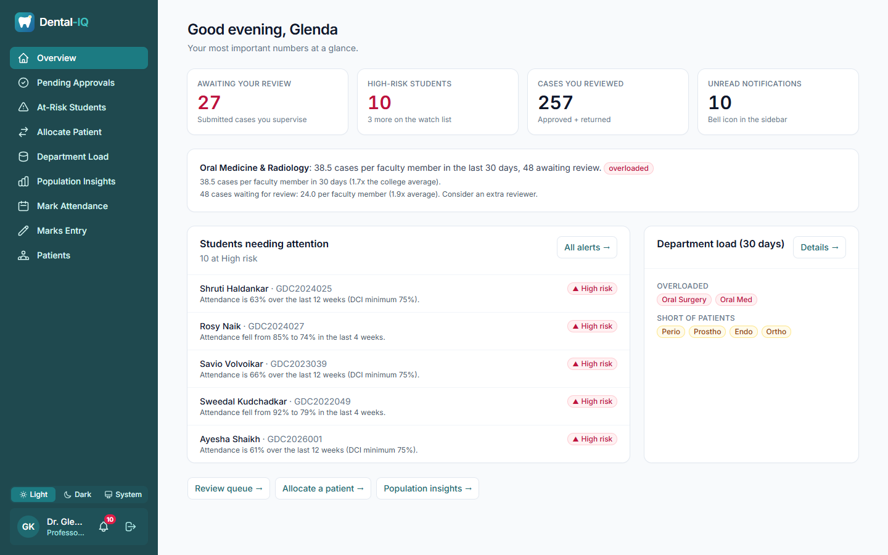
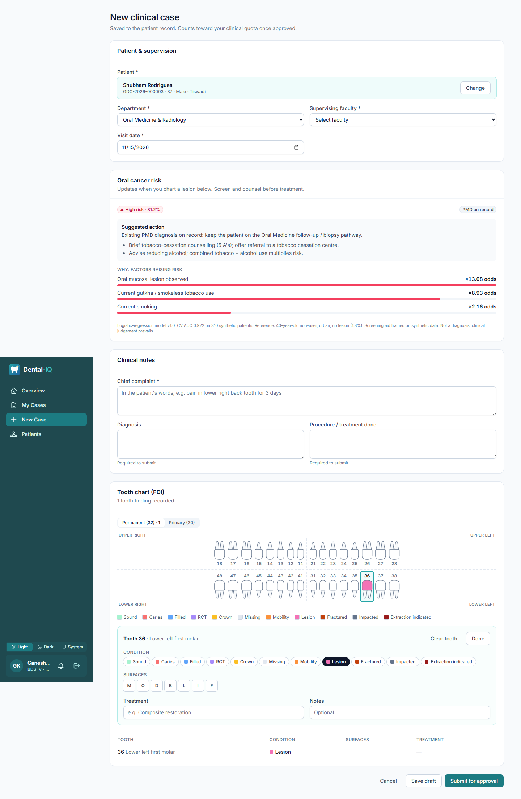
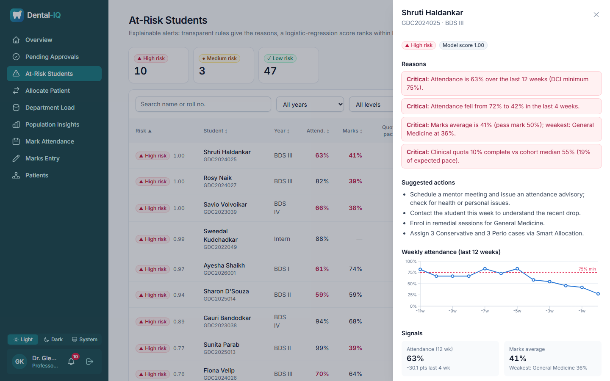
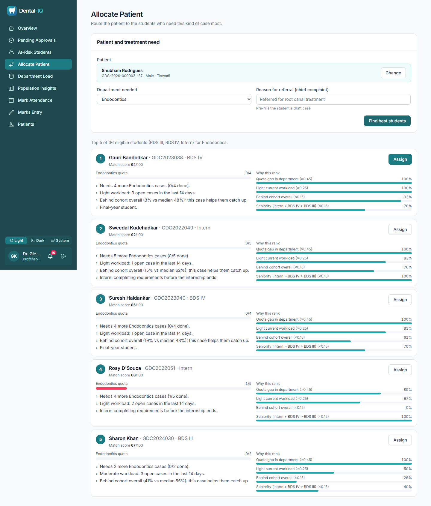
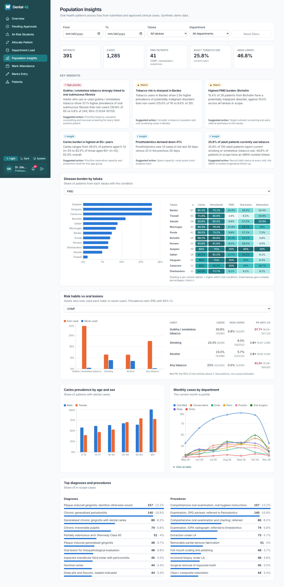
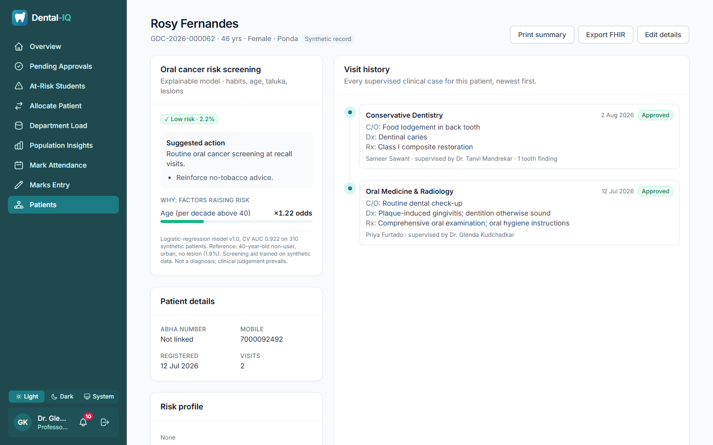
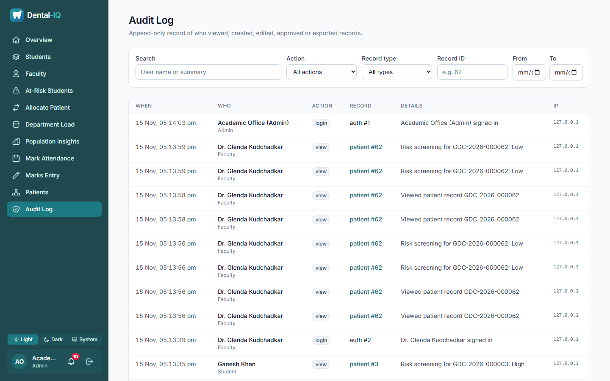
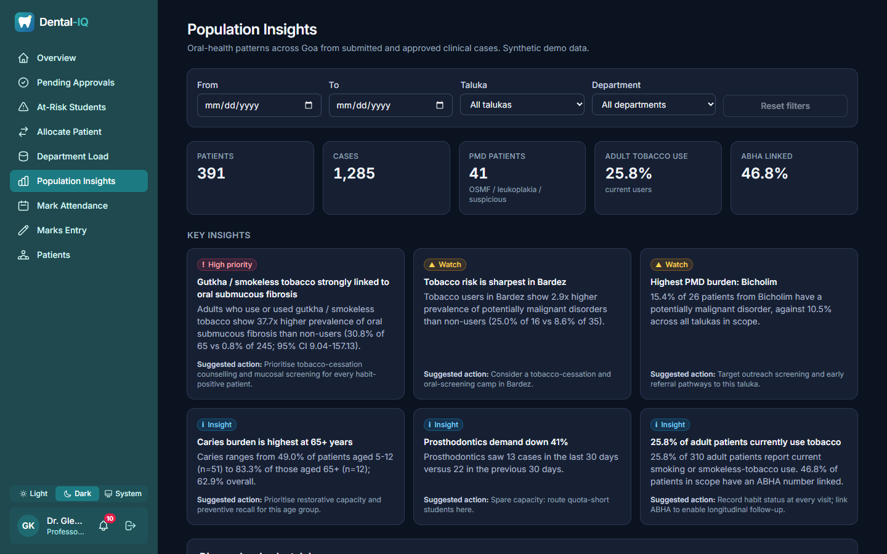
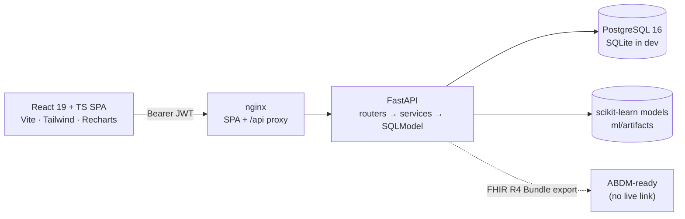

<p align="center">
  
</p>

<h1 align="center">Dental-IQ</h1>

<p align="center">
  <b>One clinical case. Three outcomes.</b><br/>
  Digital dental records, student competency and population oral-health intelligence for a dental college.<br/>
  <sub>Hackathon prototype for Goa Dental College &amp; Hospital · v1.0.0 · <b>all data is synthetic</b></sub>
</p>

---

## The problem

In a dental college, students treat hospital patients under faculty supervision. The same visit is
recorded (if at all) in a patient file, a student log book and an attendance/marks register that never
talk to each other. Faculty learn late that a student is falling behind, students hunt for the cases
their quotas need, and the college's data on tobacco-driven oral disease across Goa is never analysed.

## The solution

**One supervised case entry feeds three outcomes:**

```
Student records a case (FDI tooth chart) ──► Faculty approves / returns it with remarks
        │
        ├─► Patient record      visit history, dental chart, oral-cancer risk screening, print / FHIR export
        ├─► Student competency  quota progress, explainable at-risk alerts, learning plan, smart allocation
        └─► Population insight  taluka-wise burden, habit ↔ lesion associations, plain-language key insights
```

### Key differentiators

| | What it means in the product |
|---|---|
| **One entry, three outcomes** | Approving a case updates the EHR, the student's quota and the dashboards. No double entry |
| **India-ready** | ABHA number, gutkha / smokeless tobacco, smoking and alcohol history, Goa talukas, FHIR R4 export as the base for ABDM (no live ABDM integration yet) |
| **Explainable at-risk alerts** | Reasons such as *"Attendance fell from 72% to 42% in the last 4 weeks."* plus a suggested action; students see gentle "focus areas", not labels |
| **Smart patient allocation** | Ranks students by quota gap, workload, pace and year, with a "why" for every rank |
| **Explainable oral-cancer risk** | Odds multiplier per factor; updates live when a lesion is charted |
| **Trust** | Append-only audit trail, role-based access, rate-limited login, server-side logout, notifications |

How this compares with Dentrix, Open Dental, axiUm, college ERPs and ABDM: [docs/existing-solutions.md](docs/existing-solutions.md).

## Screenshots

| | |
|---|---|
|  **Faculty overview** |  **New case: FDI chart + live risk** |
|  **Explainable at-risk alerts** |  **Smart patient allocation** |
|  **Population insights** |  **Patient profile + risk screening** |
|  **Audit log (admin)** |  **Dark mode** |

More in [docs/screenshots](docs/screenshots): login, student overview and cases, approvals, department load,
printable summary, notifications, mobile.

## Architecture



Layers, data flow, security model and deployment: [docs/architecture.md](docs/architecture.md).

| Layer | Stack |
|---|---|
| Frontend | React 19, TypeScript, Vite, Tailwind CSS, React Router, Recharts |
| Backend | Python 3.12/3.13, FastAPI, SQLModel (SQLAlchemy 2), Alembic, PyJWT, bcrypt |
| ML | scikit-learn logistic regression (fully decomposable), NumPy, joblib |
| Data | PostgreSQL 16 (Docker) or SQLite (local dev), switched by `DATABASE_URL` |
| Ops | Docker Compose (postgres + API + nginx), GitHub Actions CI, pytest (44 tests) |

## Features by role

**Student**: overview (quota, attendance, reviews, focus) · new case with interactive FDI chart (permanent + primary teeth, keyboard accessible) and live oral-cancer risk · my cases with quota bars, focus areas and learning plan · patients · notifications.

**Faculty**: overview · pending approvals (approve / return with remarks) · at-risk students (sortable, detail drawer) · allocate patient · department load · population insights · mark attendance · marks entry · patients (print summary, FHIR export).

**Admin**: everything faculty can see (except reviewing cases) · student and faculty lists · audit log.

**Everyone**: light / dark / system theme, toasts, notification bell, account page (password change), session expiry.

Walkthrough per role: [docs/user-guide.md](docs/user-guide.md).

## Setup

### Option A: Docker (one command, PostgreSQL)

Prerequisite: Docker Desktop (or Docker Engine + Compose v2).

```bash
cp .env.example .env
# edit .env: set JWT_SECRET and POSTGRES_PASSWORD, e.g.
#   python -c "import secrets; print(secrets.token_urlsafe(48))"
docker compose up --build -d                                  # db + API (migrations run on start) + web
docker compose exec backend python -m scripts.seed --reset   # synthetic demo data + model training (~20 s)
```

Open **http://localhost:8080** (API docs: http://localhost:8080/docs). Stop with `docker compose down`
(add `-v` to delete the database volume).

> Builds failing with `CERTIFICATE_VERIFY_FAILED`? Your network or antivirus inspects HTTPS. Point
> `EXTRA_CA_CERT` in `.env` at that root certificate (PEM); it is used only at build time.

### Option B: local development (SQLite)

Prerequisites: **Python 3.11+** and **Node 18+**.

```bash
# 1. Backend  →  http://localhost:8000  (Swagger: /docs)
cd backend
python -m venv .venv
# Windows:  .venv\Scripts\activate        macOS/Linux:  source .venv/bin/activate
pip install -r requirements-dev.txt        # runtime deps + test tools
cp .env.example .env                       # Windows cmd: copy .env.example .env
python -m scripts.seed --reset             # synthetic data + trains both models (~20 s)
uvicorn app.main:app --port 8000
```

```bash
# 2. Frontend  →  http://localhost:5173  (in a second terminal)
cd frontend
npm install
npm run dev
```

Leaving `JWT_SECRET` empty in development gives a random per-process secret (you sign in again after a
restart). Set `APP_ENV=production` to enforce a strong secret, explicit CORS origins and migrations-only schema.

### Tests and checks

```bash
cd backend && python -m pytest -q             # 44 tests (set TEST_DATABASE_URL to run them on PostgreSQL)
cd frontend && npm run lint && npm run build  # 0 errors
cd backend && python -m ml.train              # retrain models + regenerate docs/ml-report.md
```

## Demo logins

One-click buttons on the login page. All demo passwords satisfy the app's password policy.

| Role | Email | Password | Try this |
|---|---|---|---|
| Student (strong, BDS IV) | `student@gdch.demo` | `Molar#2026` | Overview → New Case: chart a lesion and watch the risk card; choose Pedodontics for the primary-teeth chart |
| Student (at-risk, BDS III) | `atrisk.student@gdch.demo` | `Molar#2026` | Focus areas and learning plan |
| Faculty (HOD Oral Medicine) | `faculty@gdch.demo` | `Clinic#2026` | Notifications, Pending Approvals, At-Risk Students, Allocate Patient, Population Insights |
| Admin | `admin@gdch.demo` | `Office#2026` | Overview, Audit Log, Students / Faculty |

All other generated accounts (listed under Admin → Students / Faculty) use `Dental#2026`.

## Data and models (synthetic)

`scripts/seed.py` generates deterministic **synthetic** data (every patient is tagged `is_synthetic`):
400 patients across Goa's 12 talukas, 60 students (BDS I–IV + interns), 10 faculty, ~1,400 supervised
cases with FDI findings, 12 weeks of attendance and marks. Hidden generative models drive potentially
malignant disorders (from habits, age and taluka) and caries (rising with age: about **51% of children and
66% of adults**). Ten students are deliberately at-risk; their labels are kept outside the database for
evaluation only.

| Model | Result on the synthetic data ([docs/ml-report.md](docs/ml-report.md)) |
|---|---|
| Oral-cancer / PMD risk (logistic regression) | 5-fold CV AUC **0.92**; **0.80** without the lesion input (the honest pre-charting estimate) |
| At-risk students (rules + logistic regression) | High alerts: precision / recall **1.00 / 1.00** vs the 10 designed students; watch list 0.77 / 1.00 |

These show the models recover the generator's assumptions. **They are not clinical or academic evidence.**

## Project structure

```
backend/
  app/        core (config, security, deps, passwords, rate limit) · models · schemas · services · routers
  ml/         oral_risk · student_risk · train (CLI) · report · artifacts/ (generated)
  migrations/ Alembic          scripts/ seed       tests/ API, Phase 2, security, FHIR
  Dockerfile  docker-entrypoint.sh (alembic upgrade head → uvicorn)
frontend/
  src/        api · auth · components (ToothChart, RiskPanel, charts, NotificationBell, …) · lib · pages
  Dockerfile  nginx/default.conf
docs/         architecture · user-guide · pitch · existing-solutions · data-model · ml-report · abdm-roadmap · screenshots
docker-compose.yml   .env.example   .github/workflows/ci.yml
```

## Limitations (honest scope)

- **Synthetic data only.** Prevalences and model metrics reflect the generator, not Goa's population or the college.
- **No live ABDM integration.** ABHA numbers are format-checked, not verified. The FHIR export is validated
  against R4B models in tests, not with the official HL7 validator or the NRCeS profiles; clinical concepts
  are exported as text, not SNOMED CT. See [docs/abdm-roadmap.md](docs/abdm-roadmap.md).
- The student-risk model is trained with **weak labels** derived from its own rules; its score thresholds
  were tuned on the same data. Real deployment needs historical outcomes.
- Login rate limiting is in-memory (single API process). No refresh tokens or MFA.
- Faculty "availability" in allocation is head-count; there is no timetable data.
- Not for clinical use.

## Future scope

Pilot with consented, de-identified data and real outcome labels · ABDM sandbox → ABHA verification (M1) →
SNOMED CT coding and NRCeS bundles → HIP flows (M2) · faculty timetables and appointment scheduling ·
SMS reminders · MFA and Redis-backed rate limiting · multi-college and state-level dashboards.
One-page pitch: [docs/pitch.md](docs/pitch.md).

---
<sub>Dental-IQ · hackathon prototype · synthetic data · not for clinical use.</sub>
