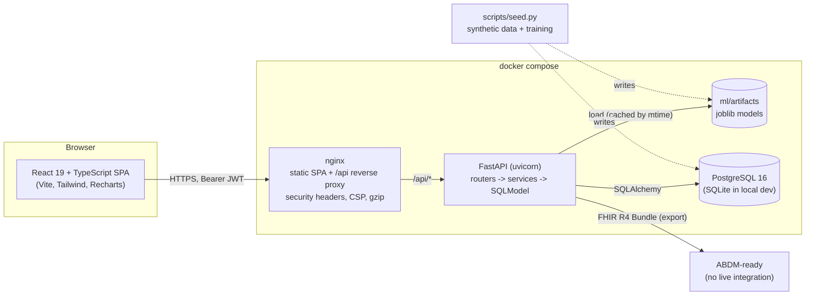
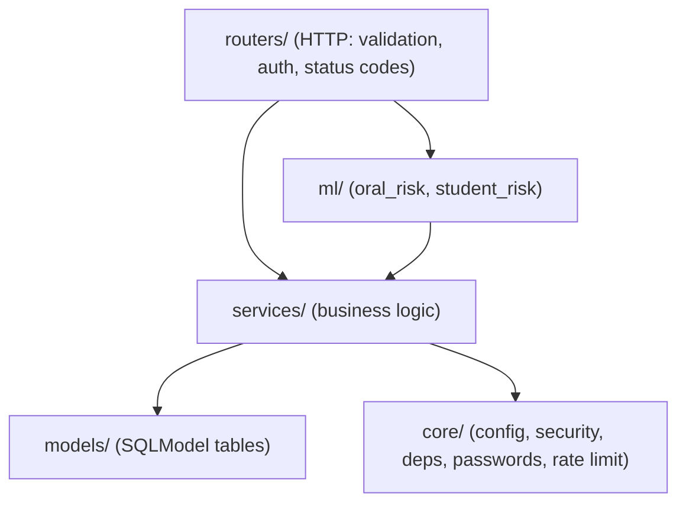
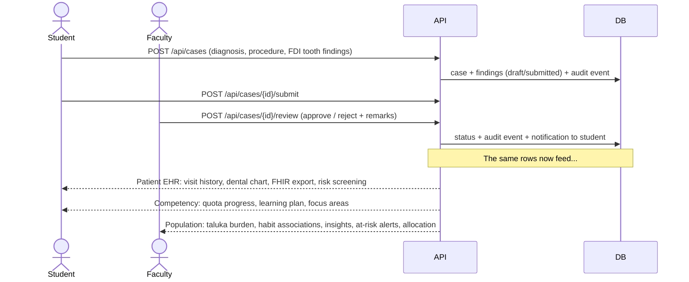
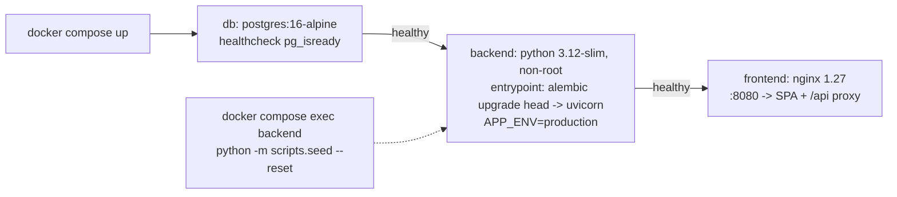

# Architecture

Dental-IQ is a single-page React app talking to a FastAPI service over a JSON REST API.
The API owns all business logic, analytics and the ML models; the browser only renders.

## System overview

## Backend layers

| Layer | Contents |
|---|---|
| `app/core` | Settings from env (secrets never hard-coded), bcrypt + JWT (with `jti`), auth/role dependencies, password policy, login rate limiter |
| `app/models` | 12 SQLModel tables: users/profiles, patient, case, tooth_finding, attendance, assessment, clinical_quota, audit_event, revoked_token, notification. `UTCDateTime` keeps timestamps timezone-aware on every database |
| `app/schemas` | Pydantic request/response models (the API contract, separate from tables) |
| `app/services` | `clinical_terms` (one disease-category definition), `analytics`, `quota`, `allocation`, `learning`, `audit`, `notifications`, `fhir`, `cases`, `academic_policy` |
| `app/routers` | auth, patients (+risk screening, FHIR export), cases, students, faculty, academic, analytics, intelligence (alerts / focus / learning plan), allocation, trust (audit + notifications), overview, admin |
| `ml/` | `oral_risk` and `student_risk` (scikit-learn logistic regression), `train` CLI, `report` (renders `docs/ml-report.md`) |
| `migrations/` | Alembic: initial schema + Phase-3 security tables |

## The core data flow: one case, three outcomes

Nothing is copied between modules: every view is computed from the same `case`, `tooth_finding`,
`patient`, `attendance` and `assessment` rows. Shared definitions keep numbers identical across pages:

- disease categories: `services/clinical_terms.py` (dashboard, insights and ML labels)
- quota progress: `services/quota.py` (progress bars, alerts, allocation, learning plan, overview)
- attendance window: `services/academic_policy.py` (attendance card, alerts, focus areas, overview)

Automated tests assert these cross-page equalities.

## Intelligence layer

| Feature | Method | Explainability |
|---|---|---|
| Population insights | SQL-loaded facts aggregated in Python; prevalence ratios with 95% CI | Every insight card carries its evidence; ranked by CI lower bound, minimum group sizes |
| Oral-cancer / PMD risk | L2 logistic regression (10 interpretable features) | Exact per-factor log-odds decomposition shown as odds multipliers + rule-based suggested action |
| At-risk students | Transparent rules + logistic regression score (weak supervision) | Rules produce reasons + actions; model shows per-signal contributions |
| Smart allocation | Weighted score: quota gap 0.45, workload 0.25, pace 0.15, seniority 0.15 | Component bars + a "why" sentence per component |

Model metrics, limitations and the synthetic-data caveat: [`ml-report.md`](ml-report.md).

## Security model

| Concern | Implementation |
|---|---|
| Authentication | bcrypt passwords; HS256 JWT with `exp` + `jti`; server-side revocation on logout (`revoked_token`) |
| Authorisation | Role dependencies (`CurrentStudent`, `CurrentFaculty`, `StaffUser`, `AdminUser`); students only see their own cases, marks, attendance and alerts |
| Secrets | `JWT_SECRET` only from the environment; production refuses to start with a missing / placeholder / short secret or wildcard CORS |
| Brute force | 5 failed logins per email + IP per 15 min -> HTTP 429 with `Retry-After`; identical response for unknown emails |
| Passwords | 8+ chars, upper, lower, digit, symbol, not common, not containing the email name (`core/passwords.py`); demo accounts comply |
| Audit | Append-only `audit_event`: record views, creates, edits, approvals, deletions, allocations, risk screenings, exports, logins, failed logins |
| Transport / browser | CORS limited to configured origins; `nosniff`, `DENY` framing, `no-referrer`, `no-store` on API responses; CSP on the SPA (nginx) |
| Schema | Alembic migrations run on container start; tables are never auto-created in production |

Known limits: the rate limiter is in-memory (single API process); there are no refresh tokens or MFA.

## Deployment

CI (`.github/workflows/ci.yml`): backend tests on SQLite **and** PostgreSQL, frontend lint + build,
`docker compose config` + image build.
