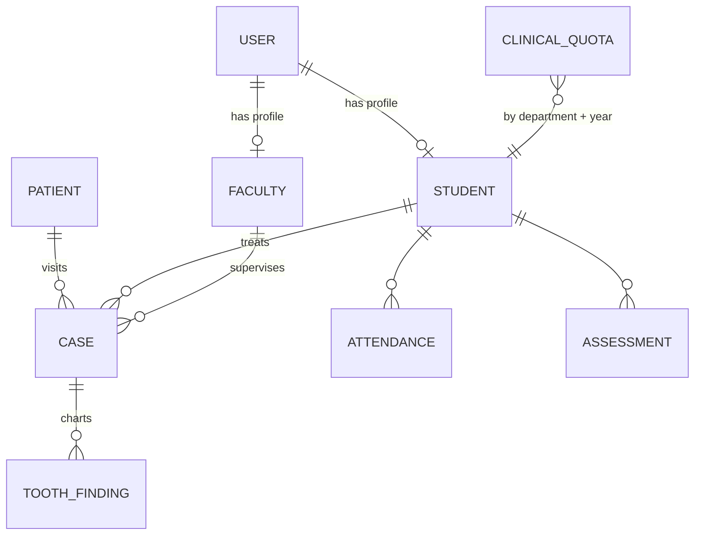

# Data Model

All tables live in `backend/app/models/`. Enum values are stored as readable lower-case strings (e.g. `oral_medicine`, `current`) so Phase-2 analytics can query the database directly.



| Table | Purpose | Key fields |
|---|---|---|
| `user` | Login identity | email (unique), password_hash (bcrypt), role `admin/faculty/student` |
| `student` | Student profile | roll_no, year `bds1..bds4/intern`, batch |
| `faculty` | Faculty profile | department, designation |
| `patient` | EHR header | opd_number, **abha_id** (optional, unique), age, sex, **taluka**, **tobacco_smoking / smokeless_tobacco / alcohol** (`never/former/current`), habit_duration_years, diabetes / hypertension / cardiac flags, allergies, notes, `is_synthetic` |
| `case` | One supervised visit | patient, student, supervising faculty, department, visit_date, chief complaint, diagnosis, procedure, status `draft → submitted → approved/rejected`, faculty_remarks |
| `tooth_finding` | Per-tooth charting in a case | FDI tooth_number (11–48), condition, surfaces (M/O/D/B/L), treatment |
| `attendance` | Daily attendance | student, date, session `theory/practical/clinic`, status; unique per (student, date, session) |
| `assessment` | Marks | subject, exam_type, marks, max_marks, exam_date |
| `clinical_quota` | Competency requirement | department, year, required_cases; unique per (department, year) |

## The core data flow

```
Student creates Case (draft) ─► adds ToothFindings ─► submits
        │
        ▼
Faculty approves / rejects with remarks
        │
        ├─► Patient profile: visit history (all statuses)
        ├─► Student competency: approved cases count toward clinical_quota per department
        └─► Population data: diagnosis + findings + patient risk factors + taluka (Phase 2)
```

## Design notes for Phases 2 and 3

- **At-risk detection (Phase 2)** needs attendance %, marks trend and quota progress. All three are queryable per student; `services/quota.py` already computes quota progress.
- **Smart allocation (Phase 2)** = quota gap per (student, department), which `GET /api/students/{id}/quota-progress` already exposes.
- **Population insights (Phase 2)** join `case` × `tooth_finding` × `patient` (taluka, habits). Indexes exist on department, visit_date, condition, taluka.
- **ABDM (Phase 3)**: `abha_id` is the linking key. A case maps naturally to a FHIR `Encounter` + `Condition` + `Procedure` bundle.
- **PostgreSQL**: set `DATABASE_URL`. Models use only portable types. Add Alembic migrations before production use.
- Clinical years: BDS 1–2 are pre-clinical, so cases and quotas apply to BDS 3, BDS 4 and interns.
