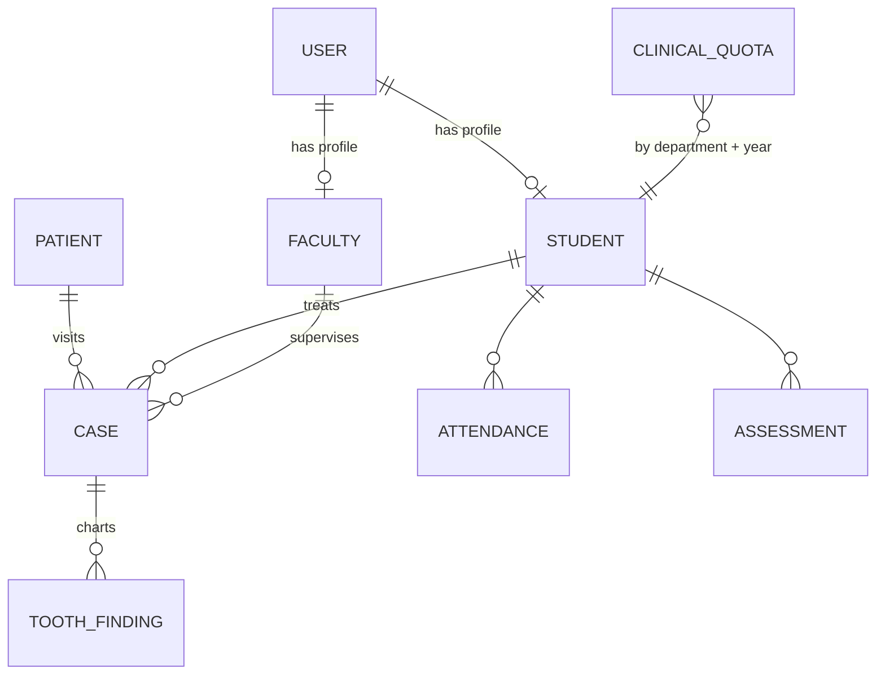

# Data Model

All tables live in `backend/app/models/`. Enum values are stored as readable lower-case strings (e.g. `oral_medicine`, `current`) so Phase-2 analytics can query the database directly.



| Table | Purpose | Key fields |
|---|---|---|
| `user` | Login identity | email (unique), password_hash (bcrypt), role `admin/faculty/student` |
| `student` | Student profile | roll_no, year `bds1..bds4/intern`, batch |
| `faculty` | Faculty profile | department, designation |
| `patient` | EHR header | opd_number, **abha_id** (optional, unique), age, sex, **taluka**, **tobacco_smoking / smokeless_tobacco / alcohol** (`never/former/current`), habit_duration_years, diabetes / hypertension / cardiac flags, allergies, notes, `is_synthetic` |
| `case` | One supervised visit | patient, student, supervising faculty, department, visit_date, chief complaint, diagnosis, procedure, status `draft → submitted → approved/rejected`, faculty_remarks |
| `tooth_finding` | Per-tooth charting in a case | FDI tooth_number (permanent 11–48, primary 51–85), condition, surfaces (M/O/D/B/L/I/F), treatment |
| `attendance` | Daily attendance | student, date, session `theory/practical/clinic`, status; unique per (student, date, session) |
| `assessment` | Marks | subject, exam_type, marks, max_marks, exam_date |
| `clinical_quota` | Competency requirement | department, year, required_cases; unique per (department, year) |

## The core data flow

```
Student creates Case (draft) ─► adds ToothFindings ─► submits
        │
        ▼
Faculty approves / rejects with remarks
        │
        ├─► Patient profile: visit history (all statuses)
        ├─► Student competency: approved cases count toward clinical_quota per department
        └─► Population data: diagnosis + findings + patient risk factors + taluka (Phase 2)
```

## How Phase 2 uses the schema

No new tables were needed: every Phase-2 feature is derived from the Phase-1 data.

| Feature | Derived from |
|---|---|
| Population insights | `case` × `tooth_finding` × `patient` (taluka, habits), categorised by `services/clinical_terms.py` |
| Oral-cancer risk model | adult `patient` habits/demographics + lesion findings; label = PMD diagnosis in a submitted/approved `case` |
| At-risk alerts | `attendance` (12-week window), `assessment`, `case` status counts, quota progress vs cohort median |
| Learning plan | quota progress per department + `assessment` per subject |
| Smart allocation | `clinical_quota` (eligibility), quota gaps, open `case` count, recent `attendance` |
| Department load | `case` volume and review backlog per department vs `faculty` head-count |

Trained models live in `backend/ml/artifacts/` (generated, git-ignored). The seed's ground-truth file there is used
only for offline evaluation and is never written to the database.

## Notes for Phase 3

- **Migrations**: Alembic is set up (`backend/migrations`); set `AUTO_CREATE_TABLES=false` outside development.
- **ABDM**: `abha_id` is the linking key; a case maps naturally to a FHIR `Encounter` + `Condition` + `Procedure` bundle.
- **Faculty availability**: allocation currently uses faculty head-count; a timetable table would enable true availability.
- **Real outcomes**: a table of academic outcomes (detained / passed / repeated) would replace weak labels for the student model.
- Clinical years: BDS 1–2 are pre-clinical, so cases and quotas apply to BDS 3, BDS 4 and interns.
